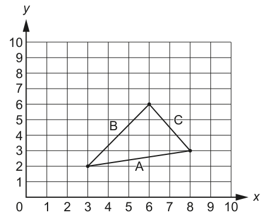
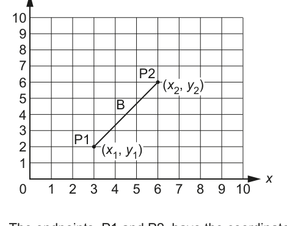

# 用坐标判断直角三角形

来源：9618_s24_21:6(a)；QP p13，MS p9，6 分。已对照 QP 原页核对下列题干、表格与示例。

先在 `answer.pseudo` 写剑桥伪代码，再把同一算法写入 Python `solution.py`，按下列接口测试。

## 英文原题与给定信息

```text
Three points on a grid form a triangle with sides of length A, B and C as shown in the example:
[Diagrams reproduced below.]
A triangle is said to be right-angled if the following test is true (where A is the length of the longest side):
A² = B² + C²
A² means A multiplied by A, for example 3² means 3 × 3 which evaluates to 9
You can calculate A², B² and C² by using the coordinates of the endpoints of each line.
For example, B² is calculated as follows:
The endpoints, P1 and P2, have the coordinates (3, 2) and (6, 6).
The value B² is given by the formula:
B² = (x₁ − x₂)² + (y₁ − y₂)²
In this example:
B² = (3 − 6)² + (2 − 6)²
B² = (−3)² + (−4)²
B² = 9 + 16
B² = 25
A function IsRA() will:
        •   take three sets of integers as parameters representing the coordinates of the three
            endpoints that form a triangle
        •   return TRUE if the endpoints form a right-angled triangle, otherwise return FALSE.
        In pseudocode, the operator ‘^’ represents an exponent, which is the number of times a value
        is multiplied by itself. For example, the expression Value² may be written in pseudocode as
        Value ^ 2
        Complete the pseudocode for the function IsRA().
        FUNCTION IsRA(x1, y1, x2, y2, x3, y3 : INTEGER) RETURNS BOOLEAN
        ENDFUNCTION
```

原页图示（只读 PDF 原图裁切，保留图形和表格排版）：





## Python 接口

入口：`IsRA(x1,y1,x2,y2,x3,y3)`。

骨架中标注为“provided”的辅助模块来自题目给定契约，不属于本小问作答；保留它们即可。未给参数名时采用该题 MS 范例的名字。题目没有模块名时，`main` 是本练习的 Python 调用入口，伪代码仍按原题写算法。

## 人工核对清单

Python 测试只核对行为；下面逐点以本题 MS 人工批改，不能把测试通过当作伪代码得分。

- [ ] MP1：Calculate the square of the length of at least one side
- [ ] MP2：Calculation of all three lengths squared correctly
- [ ] MP3：One correct comparison of square of three lengths
- [ ] MP4：All three comparisons…
- [ ] MP5：combined using logical operators / nested IF // completely correct selection
- [ ] MP6：Return result correctly in both cases
- [ ] 模块头、参数类型/顺序、RETURNS、结束行与变量声明逐项核对；只要求补算法时不额外要求函数头。
- [ ] 伪代码使用指南关键字、大写关键字与 `←`；要求 pseudocode 时，混入 Python 语法或插页外语言函数，该得分点不给（D2）。
- [ ] 不用内置查找/排序等代替题目要求的算法；数组使用题给上下界的全局声明（D10/D24）。
- [ ] 不依赖 AND 短路；先检查索引/长度，再读取元素（D25）。
