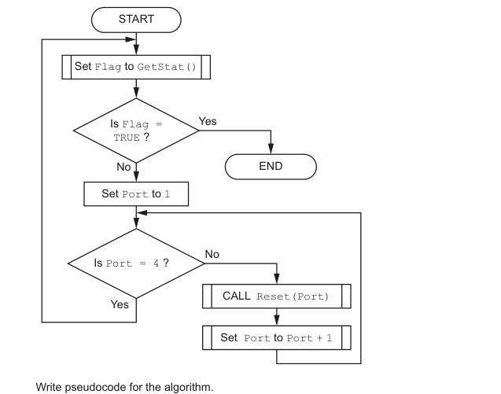

# 流程图中的状态轮询与端口重置

来源：9618_s24_22:2(b)；QP p.6，MS p.6，5 分。题干、给定定义与示例已对照原页。

先在 `answer.pseudo` 写剑桥伪代码，再把同一算法写入 Python `solution.py`。

## 英文原题与给定信息

```text

A different part of the program contains an algorithm represented by the following program
flowchart:
[Flowchart transcribed below.]
Write pseudocode for the algorithm.
```

### 流程图文字转写（QP p.6）

讲解时请对照原卷 QP p.6。

1. START → Set Flag to GetStat() → Is Flag = TRUE ?
2. Yes 分支 → END；No 分支 → Set Port to 1 → Is Port = 4 ?
3. Is Port = 4 ? 的 No 分支 → CALL Reset(Port) → Set Port to Port + 1 → 回到 Is Port = 4 ?。
4. Is Port = 4 ? 的 Yes 分支 → 回到 Set Flag to GetStat()。



## Python 接口

入口：`main()`。原题没有算法模块名，Python 用 `main()` 包装，不输入/打印。GetStat/Reset 为原图已有模块，测试注入有限状态序列；只核对图上可见的调用次序和端口1–3，不规定循环语句写法。

未命名算法的 `main()`、未命名数据的 Python 名字及未给出的文件名/字段长度仅是测试接口约定，不是原卷新要求。骨架 provided 部分为已给定模块或数据；学生完成算法。所有数值输出允许等值表示；题面指定纯输出行时不另加说明文字。输入提示使用 `input(prompt)`（D13）。

## 人工核对清单

Python 测试只核对同算法行为，不能代替按本题 MS 给分；D31：Python 边界按 QP，人工评分按 MS 得分点。下列 MP 使用语料编号；有封顶时不能把全部可选点相加当总分。

- [ ] MP1：(Outer) conditional loop testing Flag
- [ ] MP2：Correct assignment of Flag from GetStat() in a loop
- [ ] MP3：(Inner) loop checking / counting port // Check if Port is different to 4
- [ ] MP4：… loop for 3 iterations
- [ ] MP5：a call to Reset()in a loop
- [ ] 本小问总分上限 5 分。
- [ ] 按 2027–2029 指南写法，关键字大写、赋值用 ←；混入 Python 语法按 D2 判该点不给。原题无模块头则不私加。
- [ ] 数组为题定上下界的全局数组，Python 建真实 list 并说明换算（D10/D24）；不依赖 AND 短路来防止越界（D25）。
- [ ] 不用内置查找、排序、max 等替代题目要求的算法；原题未定义的边界不自行额外判分。
