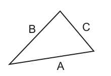

# 输入三边并判断直角三角形

来源：9618_s24_22:4；QP p8，MS p7，5 分。已对照 QP 原页核对下列题干、表格与示例。

先在 `answer.pseudo` 写剑桥伪代码，再把同一算法写入 Python `solution.py`，按下列接口测试。

## 英文原题与给定信息

```text
A triangle has sides of length A, B and C.
        B        C
             A
    In this example, A is the length of the longest side.
    This triangle is said to be right‑angled if the following equation is true:
        A × A = (B × B) + (C × C)
    A procedure will be written to check whether three lengths represent a right‑angled triangle.
    The lengths will be input in any sequence.
    The procedure IsRA() will:
    •   prompt and input three integer values representing the three lengths
    •   test whether the three lengths correspond to the sides of a right‑angled triangle
    •   output a suitable message.
    The length of the longest side may not be the first value input.
    Write pseudocode for the procedure IsRA().
```

原页图示（只读 PDF 原图裁切，保留图形和表格排版）：



## Python 接口

输出约定：只 print 一行判断结果，不另 print 输入提示；输入提示必须放在 input() 中。

入口：`IsRA()`。为统一自动核对，消息使用英文且含 right，否定消息含 not / isn't / no；不限定完整句子。提示写进 input()，伪代码提示语人工核对（D13）。

骨架中标注为“provided”的辅助模块来自题目给定契约，不属于本小问作答；保留它们即可。未给参数名时采用该题 MS 范例的名字。题目没有模块名时，`main` 是本练习的 Python 调用入口，伪代码仍按原题写算法。

## 人工核对清单

Python 测试只核对行为；下面逐点以本题 MS 人工批改，不能把测试通过当作伪代码得分。

- [ ] MP1：Procedure heading and ending and declaration of all variables used
- [ ] MP2：Appropriate prompt and input for each length
- [ ] MP3：One correct length test
- [ ] MP4：All three length tests // selection of which test is required
- [ ] MP5：Output one of two messages following a reasonable attempt at MP3
- [ ] 模块头、参数类型/顺序、RETURNS、结束行与变量声明逐项核对；只要求补算法时不额外要求函数头。
- [ ] 伪代码使用指南关键字、大写关键字与 `←`；要求 pseudocode 时，混入 Python 语法或插页外语言函数，该得分点不给（D2）。
- [ ] 不用内置查找/排序等代替题目要求的算法；数组使用题给上下界的全局声明（D10/D24）。
- [ ] 不依赖 AND 短路；先检查索引/长度，再读取元素（D25）。
