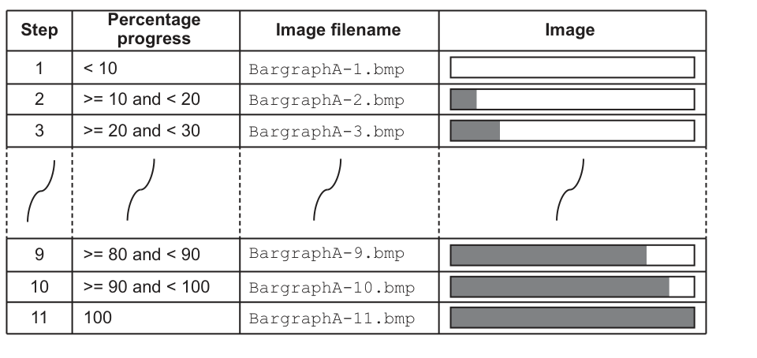

# 计算进度条图片文件名

来源：9618_s24_23:6(a)；QP p13，MS p9，6 分。已对照 QP 原页核对下列题干、表格与示例。

先在 `answer.pseudo` 写剑桥伪代码，再把同一算法写入 Python `solution.py`，按下列接口测试。

## 英文原题与给定信息

```text
A program displays a progress bar to inform the user of the progress of tasks that take a significant
    time to complete, such as those involving file transfer operations.
    Task progress is divided into 11 steps. Each step represents the amount of progress as a
    percentage. An image is associated with each step and each image is stored in a different file.
    Different progress bar images may be selected. For a given image, files all have the same filename
    root, with a different suffix.
    The table illustrates the process for using the image with filename root BargraphA
                Percentage
      Step                         Image filename                 Image
                 progress
        1    < 10               BargraphA-1.bmp
        2    >= 10 and < 20      BargraphA-2.bmp
        3    >= 20 and < 30      BargraphA-3.bmp
        9    >= 80 and < 90      BargraphA-9.bmp
       10    >= 90 and < 100    BargraphA-10.bmp
       11    100                BargraphA-11.bmp
    A procedure Progress() will:
    •   be called with two parameters:
        ○   an integer representing the percentage progress (0 to 100 inclusive)
        ○   a string representing the image filename root
    •   generate the full image filename
    •   call a procedure Display() using the full image filename as the parameter.
Write pseudocode for procedure Progress().
```

原页图示（只读 PDF 原图裁切，保留图形和表格排版）：



## Python 接口

入口：`Progress(Percent,Root)`。Display 为题给模块；测试替换为接收文件名的观察器，不要求存在实际图片文件。

骨架中标注为“provided”的辅助模块来自题目给定契约，不属于本小问作答；保留它们即可。未给参数名时采用该题 MS 范例的名字。题目没有模块名时，`main` 是本练习的 Python 调用入口，伪代码仍按原题写算法。

## 人工核对清单

Python 测试只核对行为；下面逐点以本题 MS 人工批改，不能把测试通过当作伪代码得分。

- [ ] MP1：Procedure heading, parameters and ending
- [ ] MP2：Calculate StepValue as integer value // Attempt at calculating file number
- [ ] MP3：Add 1 to obtain file number // Completely correct file number calculation
- [ ] MP4：Use of NUM_TO_STR() to convert file number to string and use
- [ ] MP5：Concatenate Root, hyphen, file number and ".bmp" suffix
- [ ] MP6：Call Display() with filename as parameter following a reasonable attempt
- [ ] 模块头、参数类型/顺序、RETURNS、结束行与变量声明逐项核对；只要求补算法时不额外要求函数头。
- [ ] 伪代码使用指南关键字、大写关键字与 `←`；要求 pseudocode 时，混入 Python 语法或插页外语言函数，该得分点不给（D2）。
- [ ] 不用内置查找/排序等代替题目要求的算法；数组使用题给上下界的全局声明（D10/D24）。
- [ ] 不依赖 AND 短路；先检查索引/长度，再读取元素（D25）。
