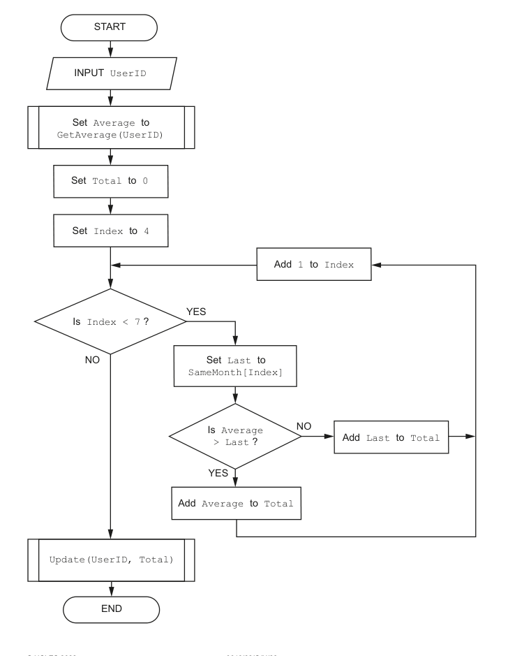

# 流程图中的三次比较累加

来源：9618_w22_22:4(a)；QP p.9，MS p.7，6 分。题干、给定定义与示例已对照原页。

先在 `answer.pseudo` 写剑桥伪代码，再把同一算法写入 Python `solution.py`。

## 英文原题与给定信息

```text

The program flowchart represents a simple algorithm. (QP p8)
[Flowchart transcribed below.]
(a) Write the equivalent pseudocode for the algorithm represented by the flowchart. (QP p9)
```

### 流程图文字转写（QP p.8）

讲解时请对照原卷 QP p.8（本小问答题区在 p.9）。

1. START → INPUT UserID → Set Average to GetAverage(UserID) → Set Total to 0 → Set Index to 4。
2. Is Index < 7 ?：No → Update(UserID, Total) → END；Yes → Set Last to SameMonth[Index]。
3. Is Average > Last ?：Yes → Add Average to Total；No → Add Last to Total。
4. 两分支汇合 → Add 1 to Index → 回到 Is Index < 7 ?。



MS p.7 另接受 FOR Index 4 TO 6；该分支 MP2 只需初始化 Total，MP3 核对 FOR 循环边界，MP5 核对 IF 比较，其他点对应原 MS 同号；不能额外要求 FOR 方案先写 Index←4。

## Python 接口

入口：`main()`。`main()` 输入 UserID 字符串；GetAverage(UserID)、Update(UserID, Total) 为 provided 外部模块，测试替换。SameMonth 为真实 list，Python 下标=QP下标−1，只需含原图用到的4–6号元素（starter容量6仅为示例）；按图比较累加后恰调用一次 Update，不额外打印。

未命名算法的 `main()`、未命名数据的 Python 名字及未给出的文件名/字段长度仅是测试接口约定，不是原卷新要求。骨架 provided 部分为已给定模块或数据；学生完成算法。所有数值输出允许等值表示；题面指定纯输出行时不另加说明文字。输入提示使用 `input(prompt)`（D13）。

## 人工核对清单

Python 测试只核对同算法行为，不能代替按本题 MS 给分；D31：Python 边界按 QP，人工评分按 MS 得分点。下列 MP 使用语料编号；有封顶时不能把全部可选点相加当总分。

- [ ] MP1：Input UserID and use of GetAverage()and assignment
- [ ] MP2：Initialisation of Total to zero and Index to 4
- [ ] MP3：Conditional loop with Index from 4 to 6
- [ ] MP4：Assignment of Last from element SameMonth[Index] in a loop
- [ ] MP5：Structure: IF...THEN...ELSE...ENDIF in a loop
- [ ] MP6：Correct assignments and final call to Update()after the loop
- [ ] 本小问总分上限 6 分。
- [ ] 按 2027–2029 指南写法，关键字大写、赋值用 ←；混入 Python 语法按 D2 判该点不给。原题无模块头则不私加。
- [ ] 数组为题定上下界的全局数组，Python 建真实 list 并说明换算（D10/D24）；不依赖 AND 短路来防止越界（D25）。
- [ ] 不用内置查找、排序、max 等替代题目要求的算法；原题未定义的边界不自行额外判分。
