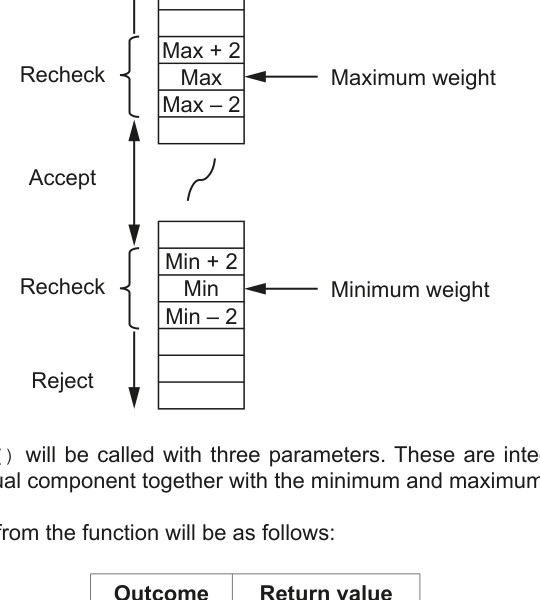

# 判断重量接收、拒绝或复检

来源：9618_w22_23:6(b)；QP p11，MS p7，6 分。已对照 QP 原页核对下列题干、表格与示例。

先在 `answer.pseudo` 写剑桥伪代码，再把同一算法写入 Python `solution.py`，按下列接口测试。

## 英文原题与给定信息

```text
Components are weighed during manufacture. Weights are measured to the nearest whole gram.
    Components that weigh at least 3 grams more than the maximum weight, or at least 3 grams less
    than the minimum weight, are rejected.
    A component is rechecked if it weighs within 2 grams of either the maximum or minimum weight.
    The final outcome of weighing each component is shown below:
                       Outcome     Weight
                         Reject
                                     Max + 2
                        Recheck       Max          Maximum weight
                                     Max – 2
                         Accept
                                     Min + 2
                        Recheck       Min          Minimum weight
                                     Min – 2
                         Reject
    A function Status() will be called with three parameters. These are integers representing the
    weight of an individual component together with the minimum and maximum weights.
    The value returned from the function will be as follows:
                                Outcome     Return value
                               Accept            'A'
                               Reject             'R'
                               Recheck           'C'
Write pseudocode for Status().
```



## Python 接口

入口：`Status(Actual,Min,Max)`。

骨架中标注为“provided”的辅助模块来自题目给定契约，不属于本小问作答；保留它们即可。未给参数名时采用该题 MS 范例的名字。题目没有模块名时，`main` 是本练习的 Python 调用入口，伪代码仍按原题写算法。

## 人工核对清单

Python 测试只核对行为；下面逐点以本题 MS 人工批改，不能把测试通过当作伪代码得分。

- [ ] MP1：Function heading and ending including parameters
- [ ] MP2：Declaration of local variable for Result / alt mechanism
- [ ] MP3：Check for Reject
- [ ] MP4：Check for Accept
- [ ] MP5：Check for Recheck (or just default to third option)
- [ ] MP6：Return Result following a reasonable attempt
- [ ] 模块头、参数类型/顺序、RETURNS、结束行与变量声明逐项核对；只要求补算法时不额外要求函数头。
- [ ] 伪代码使用指南关键字、大写关键字与 `←`；要求 pseudocode 时，混入 Python 语法或插页外语言函数，该得分点不给（D2）。
- [ ] 不用内置查找/排序等代替题目要求的算法；数组使用题给上下界的全局声明（D10/D24）。
- [ ] 不依赖 AND 短路；先检查索引/长度，再读取元素（D25）。
